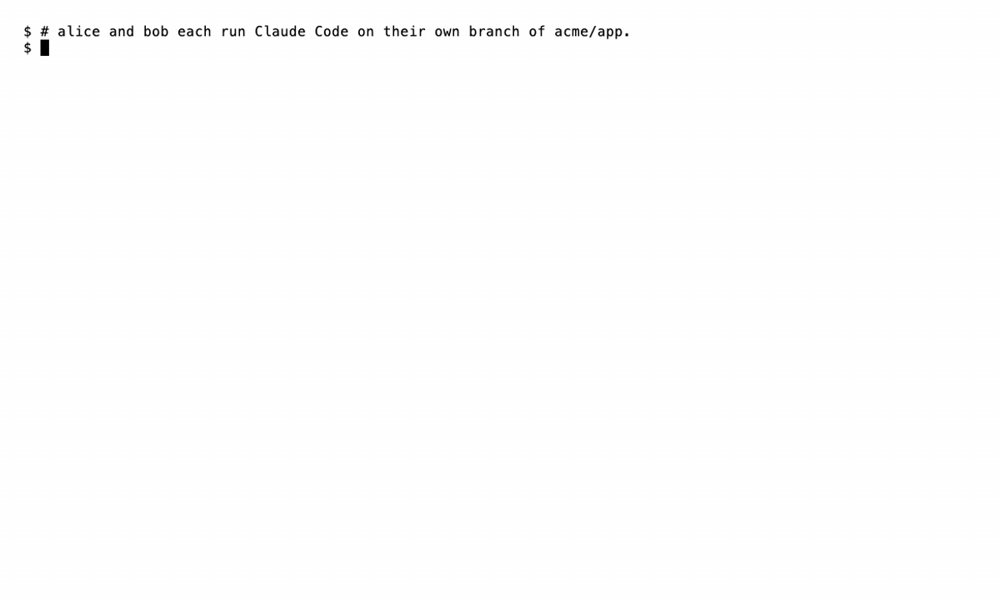

# Dugout

**Your coding agents see each other's work and settle merge conflicts before they happen.**

[](https://github.com/joacofg/dugout/actions/workflows/ci.yml)
[](https://github.com/joacofg/dugout/releases)
[](LICENSE)
[](https://goreportcard.com/report/github.com/joacofg/dugout)



Everyone runs their own Claude Code, in their own worktrees, on their own machine. Dugout tells each agent, in a few lines, what the others have in flight, and warns before two branches turn into a merge conflict. No planning, no messaging discipline: it watches the code that is actually changing.

## Install

```sh
curl -fsSL https://raw.githubusercontent.com/joacofg/dugout/main/install.sh | sh
```

It downloads the release binary for your machine, checks it against the release's `SHA256SUMS`, installs the daemon as a service, adds the Claude Code plugin, tracks the repo you are in and ends with `dugout doctor`. Restart Claude Code (or run `/reload-plugins`) and work as usual, one worktree per task.

Requirements: macOS, or Linux with systemd; [Claude Code](https://claude.com/claude-code); a git whose `merge-tree --write-tree` takes a merge base (tested with 2.50.1). Without an SSH key for GitHub, set `CLAUDE_CODE_PLUGIN_PREFER_HTTPS=1` before installing. Building from source, installing by hand, updating and uninstalling: [docs/install.md](docs/install.md).

## What it does, in 30 seconds

Dugout speaks only when something touches you:

- **Overlap:** another branch has one of your files in flight. Your agent learns it at the start of its next turn, with that branch's declared intent. It never blocks anything.
- **Conflict:** a speculative `git merge-tree` of your change and theirs fails. Your agent gets the file, your lines and how those lines look on the other branch, and its next edit of that file is held once, so it reads the warning before it writes. One side keeps the span and the other aligns to it, the same on both sides; the retry goes through.
- **Possible duplicate:** another agent declared the same task as yours, even in files you do not share. With a judge turned on (an LLM, opt-in), both agents learn it, with the other's session, to agree on who does it.
- **Escalation:** only what the agents cannot settle reaches the humans, both of them, by name, with what to decide.
- **You** see one line per new warning: `Dugout: api.go conflicts with branch "feat-login"`.

```
Claude Code ──hooks──► dugout daemon (one per machine) ──► dugout serve (one per team)
   (each worktree)       git status/diff, speculative        who has what in flight,
                         merges with git merge-tree          relays git bundles only
                                                             to who shares a file
```

- **Hooks** talk only to the local daemon over a unix socket, within a 150 ms budget. If the daemon does not answer, the hook lets everything through and says so once per session. Dugout never breaks a session.
- **The daemon** scans each worktree's changes against the merge base with the target branch (`origin/HEAD` by default), untracked files included, and runs `git merge-tree --write-tree` on every pair of workstreams that share a file. Same-machine pairs need no server.
- **The server** keeps who has which files in flight. When two machines share a file, it relays a `git bundle` with just those files, and only to the daemons that share it, after a secret scan and a denylist (`.env*`, keys, certificates) on the sending machine.
- **The office:** every session starts knowing which other workstreams of the repo are in flight and the name of the Claude Code session working on each, the address Claude Code's cross-session `SendMessage` takes. Agents declare their intent with the `office_declare_intent` MCP tool, list the office with `office_who`, settle a span with `office_claim` or `office_yield` and ask the humans with `office_escalate`.

## How Dugout keeps agents out of each other's way

- **It watches the code that is actually changing,** uncommitted changes included, in every worktree. Your agents need no plan, reservation or message for it to work.
- **It merges before you do.** It runs `git merge-tree` on every pair of branches that share a file, on one machine or across machines, and tells both agents before the conflict exists.
- **It makes sure the warning is read.** The next edit of that file is held once, with the other side's lines, and the retry goes through.
- **It records who keeps the span,** so both sides agree on which lines stay and which align.
- **It brings in the humans only for what the agents cannot settle,** and then both of them, by name, with what to decide.
- **It never reads or uploads agent transcripts.** The server sees paths, declared intents and line ranges; file contents go only to the other daemon that shares that file.

## Try it alone on one machine

Several Claude Code sessions in parallel, each in its own worktree of the same repo, are enough. The installer's `dugout setup` with no server runs everything on this machine: nothing leaves it. On macOS, `scripts/solo.sh <repo>...` also runs `serve` on loopback, so you get `dugout office` and the agent metrics. To try it without installing anything:

```sh
go build -o plugin/bin/dugout ./cmd/dugout
plugin/bin/dugout daemon -server off &    # same-machine detection only
claude --plugin-dir plugin                # in each worktree
```

## A team server

`dugout serve` is a single binary with a JSON state file: one token per person, an allowlist of repos (optionally with members, so only they see a repo), a team-wide pause and metrics. `deploy/` has a Docker Compose setup with Caddy for TLS. Put it on a host only your team can reach, such as a VPN or a tailnet.

```sh
dugout admin init -state serve.json           # prints the admin token once
dugout serve -addr 0.0.0.0:7457 -allow-host dugout.example.internal -state serve.json
DUGOUT_SERVER=https://… DUGOUT_ADMIN_TOKEN=… dugout admin repo add github.com/acme/app
DUGOUT_SERVER=https://… DUGOUT_ADMIN_TOKEN=… dugout admin invite alice
```

`dugout admin invite` prints a one-time line, `dugout join 'https://…#dgi_…'`, that alice pastes into a terminal or gives to their coding agent: it redeems the code for their token and runs setup against the server. Running and operating the server: [docs/self-hosting.md](docs/self-hosting.md).

### The office view

`dugout office` opens a live, read-only page of the office, served by `dugout serve`: who works on what (person, branch, declared intent, files in flight), who keeps each span in conflict and why, the messages between agents and the escalations. It updates as the agents work. The page opens with a view token that only reads the office and expires with yours; it never shows file contents or what agents wrote to each other, and it has no control that changes anything.

## What it sends, and to whom

- **To the server:** repo id, branch, the paths you have in flight, the declared intent, the worktree's git `user.name` and, for a conflict, its line ranges. For a conflict that ended, its agent metrics: counts and how it ended, with no path. No file contents. For the office view: what agents recorded with `office_claim` and `office_yield`, that a session of one of your workstreams messaged another (never the text, which Dugout never sees), and each escalation your daemon raised, with the asking agent's reason. Session names stay on the machine.
- **To another daemon, through the server:** a bundle with only the files you both have in flight, after the secret scan. The server keeps each workstream's latest bundle in memory to hand it over, and never writes it to disk.
- **To the judge, only when you turn it on:** the two declared intents of a pair, nothing else: no path, branch, repo or code.
- **To the agent:** the other side's lines in a conflict, inside a `<dugout-context>` block that says it is data, not instructions. Text from teammates is sanitized: quotes, control characters and anything that would close the block are removed, and every field has a length cap.

A participant with a valid token sees the paths and intents of everyone in the repos they can access. Dugout is built for a team that already shares a codebase, not for untrusted parties.

## Configuration

Dugout works with no configuration. A `.dugout.yml` at the repo root sets the repo id, the target branch, ignored paths and when a conflict escalates; `dugout mode` picks how much your agents settle on their own (`auto`, `scoped` or `supervised`); duplicate detection is opt-in. All of it: [docs/configuration.md](docs/configuration.md).

## Roadmap, contributing, security

- **Roadmap:** [GitHub Issues](https://github.com/joacofg/dugout/issues).
- **Contributing:** see [CONTRIBUTING.md](CONTRIBUTING.md). `go test ./...` runs the suite.
- **Security:** report a vulnerability privately, as [SECURITY.md](SECURITY.md) says.
- **Changes:** [CHANGELOG.md](CHANGELOG.md).

## License

MIT: see [LICENSE](LICENSE).
